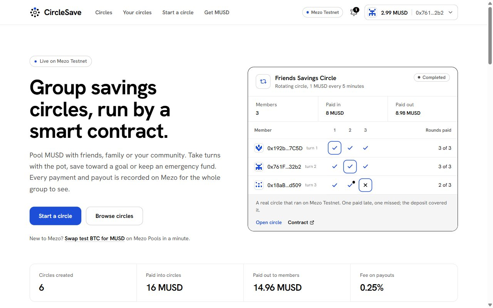
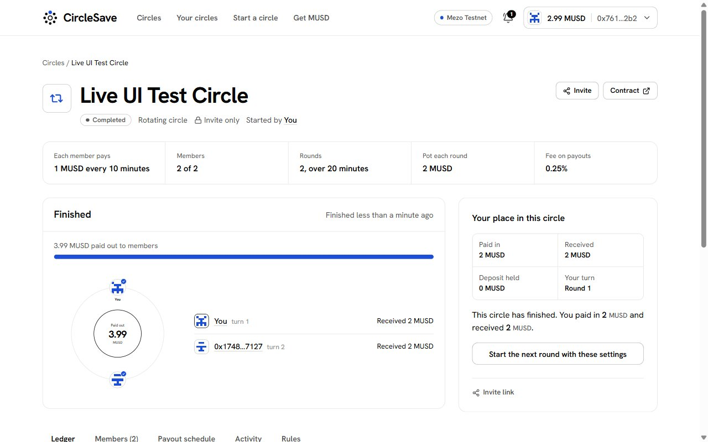
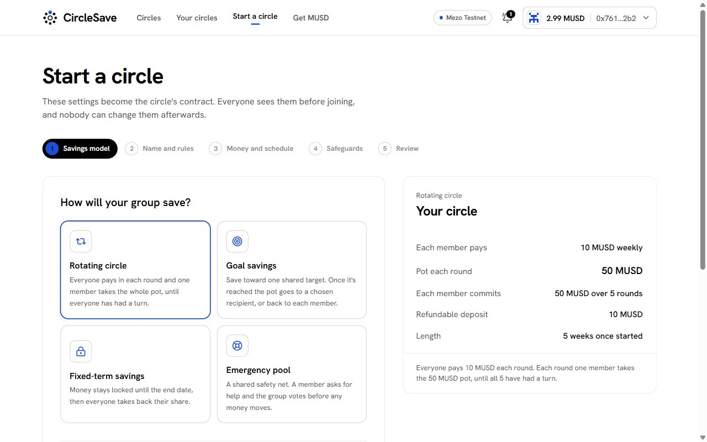
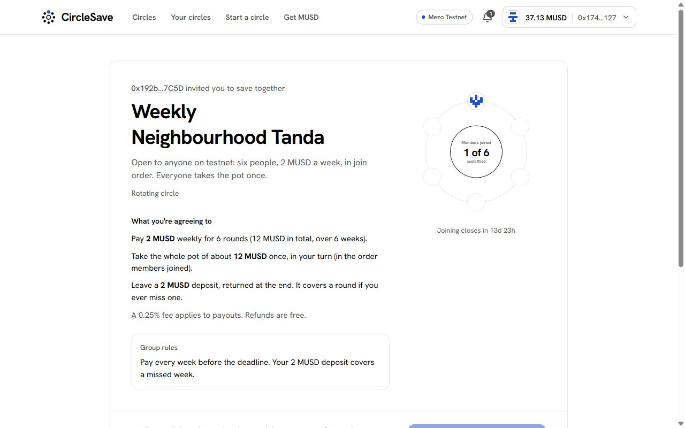
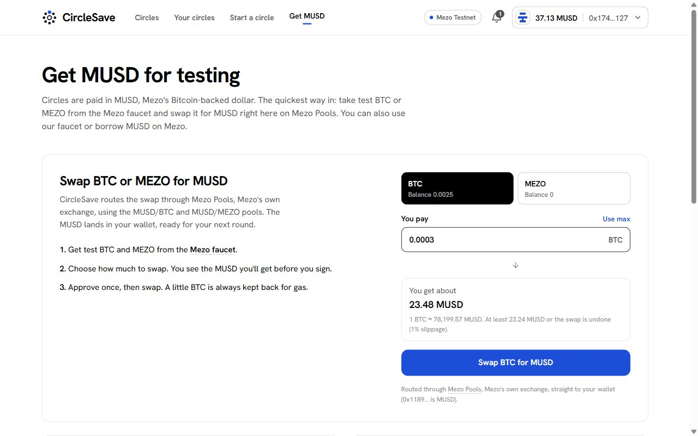
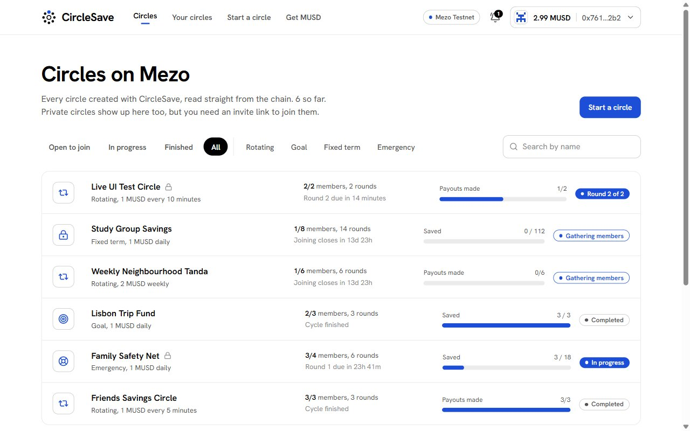
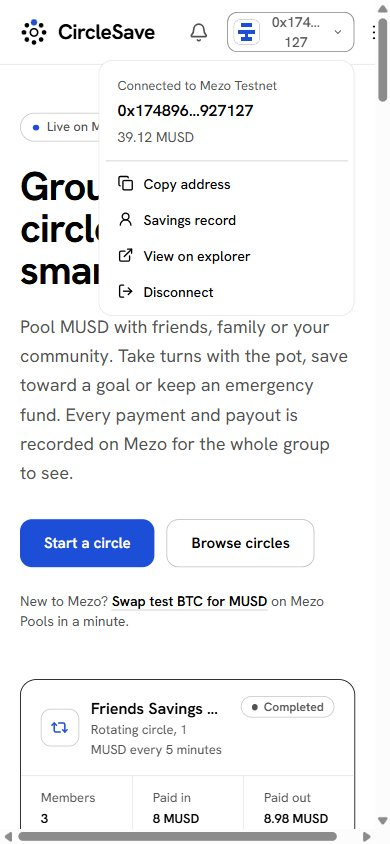
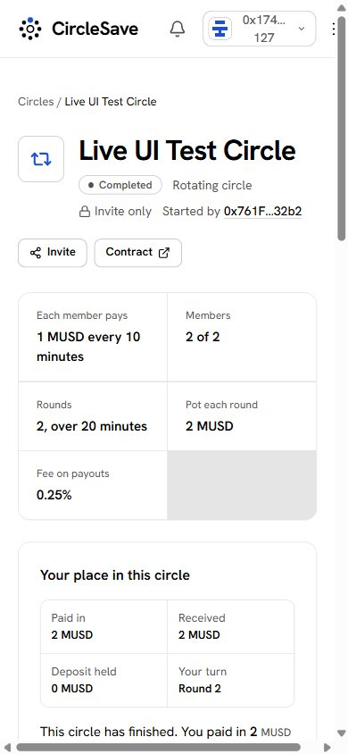

# CircleSave

**Group savings circles on Mezo, paid in MUSD.** Friends, families and communities pool MUSD in a smart
contract that keeps the book. Every contribution, payout and vote is recorded on-chain, so nobody has to
trust a treasurer or a notebook.

**Live app:** https://circlesave-mezo.vercel.app · **Network:** Mezo Testnet (chain 31611) · **Demo video:** [`docs/demo/circlesave-demo.mp4`](docs/demo/circlesave-demo.mp4)



Rotating savings groups are among the most widely used financial tools in the world: tandas in Mexico,
susus in West Africa and the Caribbean, chit funds and committees in South Asia, chamas in Kenya. They run on
trust in one treasurer. CircleSave moves the treasurer into a contract on Mezo and makes MUSD the money people save in.

## Try it in two minutes

1. Get test BTC from the [Mezo faucet](https://faucet.test.mezo.org) and open [**Get MUSD**](https://circlesave-mezo.vercel.app/get-musd).
   Swap a little BTC for MUSD on Mezo Pools, inside the app (or claim 20 MUSD from the CircleSave faucet).
2. Join the open [Weekly Neighbourhood Tanda](https://circlesave-mezo.vercel.app/join/0x17dbcA35B2695Ea26143a0f146fa12E3b38Aa01d),
   or [start your own circle](https://circlesave-mezo.vercel.app/create). Pick **10 min** rounds to run a whole circle in one sitting.
3. Share the invite link with a second wallet, start the circle, pay, and release the pot. The ledger, the
   activity feed and every explorer link update as you go.
4. Look at a finished circle, the [Friends Savings Circle](https://circlesave-mezo.vercel.app/circle/0x5CC5f4c7F572162f81e92E286f84dD1d2B1683a6):
   three members, three payouts, one late payment and one missed round covered by the deposit.

## How CircleSave uses Mezo

| | |
| --- | --- |
| **MUSD is the unit of account** | Contributions, deposits, payouts, refunds and fees are all MUSD. |
| **MUSD `permit` (EIP-2612)** | Joining and paying use `joinWithPermit` and `contributeWithPermit`: one signature and one transaction, with no separate approval. The permit covers the deposit plus every scheduled round, so later payments need no approval either. |
| **Mezo Pools** | Users swap BTC or MEZO into MUSD inside the app through Mezo's own router (MUSD/BTC and MUSD/MEZO pools). Whenever a member is short of MUSD, the swap is offered right where they pay. |
| **Built for Mezo's EVM** | Solidity 0.8.28 compiled for `london`, OpenZeppelin 5.0.2 (no `mcopy`), per-action gas floors because Mezo's gas estimates can come in low, and event reads chunked to the RPC's 10k-block limit. |
| **No randomness on Mezo** | `BLOCKHASH` and `PREVRANDAO` both return zero on Mezo Testnet (checked against the live RPC), so a "random" payout order could be gamed by whoever calls `start()`. CircleSave rejects it and uses verifiable orders: join order, or an order the creator sets that members see before the start. |

## What it does



| Model | How money moves | Safeguards |
| --- | --- | --- |
| **Rotating** (tanda, susu, chit fund) | Everyone pays each round and one member takes the whole pot, in join order or an order the creator sets before the start. | A deposit covers a missed round. Anything it can't cover becomes debt, withheld from the defaulter's own payout and returned to whoever came up short. Open circles must hold a deposit. |
| **Goal** | Members save toward a target with scheduled payments and optional top-ups. | When the goal is reached the pot goes to a chosen wallet or back to members. A missed deadline means a fee-free refund. |
| **Fixed term** | Money is locked until the end date, then shared out in proportion to what each member paid. | Leaving early costs a penalty that stays with the members who remain. |
| **Emergency pool** | A member asks for help and the group votes. | Invite only. Only members who are up to date can vote, and one request can take at most half the pool. Approvals expire. |

Every non-rotating circle can also be closed early by a vote, with a fee-free refund.

**On-chain, not in a database.** The app has no backend. Circle settings and the group's written rules, membership
and payout order, a per-member per-round payment ledger (paid, late, missed), deposits, debts, proposals and votes,
an activity log and a savings record for every wallet all live in contract state. The app reads them through a lens
contract and links every activity entry to the Mezo explorer.

**Private circles.** The invite key is derived from a signature by the creator's wallet and travels in the link's URL
fragment, which never reaches a server. It signs each joiner's own address, so an invite can't be replayed from
on-chain data.

| Create a circle | Join from an invite |
| --- | --- |
|  |  |
| **Swap BTC for MUSD on Mezo Pools** | **Browse every circle on Mezo** |
|  |  |

| Phone: landing | Phone: circle |
| --- | --- |
|  |  |

## Deployed contracts (Mezo Testnet, all source-verified)

| Contract | Address | Role |
| --- | --- | --- |
| `CircleFactory` | [`0x08ED77459FeAEC0346a07621534A55c34BE1684c`](https://explorer.test.mezo.org/address/0x08ED77459FeAEC0346a07621534A55c34BE1684c) | Creates circles (EIP-1167 clones), the only MUSD spender, savings records, fees, time-limited pause |
| `SavingsCircle` (implementation) | [`0x8330C0FFd0D4781b6EA0951C4211d8ff8bC8be0f`](https://explorer.test.mezo.org/address/0x8330C0FFd0D4781b6EA0951C4211d8ff8bC8be0f) | Rules for every circle: membership, payments, payouts, deposits, debts, activity log |
| `CircleGovernor` | [`0xe6893C4A6E2cbd388d687677EEB35A6055725BB3`](https://explorer.test.mezo.org/address/0xe6893C4A6E2cbd388d687677EEB35A6055725BB3) | Group voting: emergency requests and early closing |
| `CircleLens` | [`0x0cE07B5825fBD23D9070FC348695ddE2E109306d`](https://explorer.test.mezo.org/address/0x0cE07B5825fBD23D9070FC348695ddE2E109306d) | Read-only views used by the app |
| `MusdFaucet` | [`0x5a8c02A8634f0D689b845aF50d4548B09Db6ceE7`](https://explorer.test.mezo.org/address/0x5a8c02A8634f0D689b845aF50d4548B09Db6ceE7) | Testnet helper that drips real testnet MUSD |
| MUSD | [`0x118917a40FAF1CD7a13dB0Ef56C86De7973Ac503`](https://explorer.test.mezo.org/address/0x118917a40FAF1CD7a13dB0Ef56C86De7973Ac503) | Mezo's Bitcoin-backed dollar |
| Mezo Pools router | [`0x9a1ff7FE3a0F69959A3fBa1F1e5ee18e1A9CD7E9`](https://explorer.test.mezo.org/address/0x9a1ff7FE3a0F69959A3fBa1F1e5ee18e1A9CD7E9) | Mezo's own exchange, used for BTC/MEZO to MUSD swaps |

Factory owner and fee recipient: `0x192baEd8d1bA5a94391DbCbe87C1A2e5f6E07C5D`. The fee is 0.25% of payouts, fixed per
circle when it's created and capped at 2% in the contract. Refunds are always free.

## Live on Mezo Testnet

**Through the production UI.** A private two-member rotating circle, [Live UI Test Circle](https://circlesave-mezo.vercel.app/circle/0x07E863D1E78Ed043a7F768ccaefE0CcD39Cb31c4),
was run start to finish on https://circlesave-mezo.vercel.app by two wallets. The second wallet started with BTC only:

| Step | Transaction |
| --- | --- |
| Create the circle in the wizard (creator's deposit included) | [`0xdc1f1e3c…`](https://explorer.test.mezo.org/tx/0xdc1f1e3ca84a7a0de91c31b8bbb99a5db965d173ed3e0422ce004f71e8331d97) |
| Swap BTC for MUSD on Mezo Pools (after a one-time BTC approval) | [`0x8170cff6…`](https://explorer.test.mezo.org/tx/0x8170cff61d50b58b271e1b1190df6ab358bb529cb15bea1212a00695932c5c11) |
| Join from the invite link with an MUSD permit, in one transaction | [`0x7abc1f63…`](https://explorer.test.mezo.org/tx/0x7abc1f63ab50ee41098826d2a274791b87c437d9af6b516055b9e73188b1f9cf) |
| Start the circle | [`0xdc5ffaa0…`](https://explorer.test.mezo.org/tx/0xdc5ffaa0e7b1d5db153ebb1a7c872f311fc09df3170090f510b4e9777d7bf50e) |
| Round 1: both pay, then the pot is released | [`0x0dd91fe0…`](https://explorer.test.mezo.org/tx/0x0dd91fe0dfa8fd392e46a73d62e70520c5c4c6ce7d77378a220be6367719a2b0), [`0x81039197…`](https://explorer.test.mezo.org/tx/0x810391971c108b372198e6b66a8ed60862962bc69a761f0bc83c6f9ecc4ec60f), [`0x8af18f32…`](https://explorer.test.mezo.org/tx/0x8af18f32bbef5fd1f1c84b8476a22094c6b624c8792783cdf26f63daa4f91916) |
| Round 2: both pay, the final pot completes the circle | [`0x2c82af4e…`](https://explorer.test.mezo.org/tx/0x2c82af4e224710b7f1aa08c20f4b53c3da562d7cb54d8d5acb5271ab96e82b35), [`0xe1152df1…`](https://explorer.test.mezo.org/tx/0xe1152df1996d69ecca9ddc0866675f3756cd49050e8b5267d7aef7dec78a4274), [`0x0d619ff7…`](https://explorer.test.mezo.org/tx/0x0d619ff7963680fcb96007a279fdf57195adb8a89685499f560033e82f7a5f5c) |
| Both deposits withdrawn | [`0x0ee0602b…`](https://explorer.test.mezo.org/tx/0x0ee0602b236a3156839582700c649fce5c932e33855e83a12966e207dbe06f97), [`0xeb4dd625…`](https://explorer.test.mezo.org/tx/0xeb4dd6257995dd2ad4da4159251cef44124fe93c2ee55b36f8584072169bcd9a) |

**Scripted scenario.** `web/scripts/e2e-testnet.ts` runs every model against the live contracts with three separate wallets:

| Circle | What happened on-chain |
| --- | --- |
| [Friends Savings Circle](https://circlesave-mezo.vercel.app/circle/0x5CC5f4c7F572162f81e92E286f84dD1d2B1683a6) | Rotating, 3 members. All three rounds paid out. One member paid round 2 late, then missed round 3; her deposit covered it, so the pot was still full. Deposits withdrawn. |
| [Family Safety Net](https://circlesave-mezo.vercel.app/circle/0x846F7750c083068c754DEbd85c0014f5E0f2667A) | Private emergency pool joined with signed invites. Requests voted on and paid out by the group. |
| [Lisbon Trip Fund](https://circlesave-mezo.vercel.app/circle/0xF2Fcda4A95a5cac0F42b152fFb7D91dF6b1b445d) | Goal circle. Scheduled payments plus a top-up reached the target, and the pot went to the beneficiary. |
| [Weekly Neighbourhood Tanda](https://circlesave-mezo.vercel.app/join/0x17dbcA35B2695Ea26143a0f146fa12E3b38Aa01d) | Open rotating circle, anyone can join. |
| [Study Group Savings](https://circlesave-mezo.vercel.app/join/0x5a32a6bDC0e549750C9ba16761D30329aEdD7B89) | Open fixed-term circle, anyone can join. |

## Security

The contracts were reviewed function by function before the v2 redeploy. Twelve findings (one high) were fixed,
each with a regression test. The details are in [`docs/SECURITY.md`](docs/SECURITY.md).

- `ReentrancyGuard` on every state-changing entry point, and `SafeERC20` for every transfer.
- The factory is the only MUSD spender. Only registered circles can pull funds, and only from the caller.
- Money leaves only through rule-checked paths. There is no admin withdrawal of member funds.
- A pause lifts itself after 14 days, ownership can't be renounced, and claims and refunds keep working while paused.
- Limits: 50 members, 120 rounds, contributions from 0.01 MUSD.
- **59 Foundry tests**, including fuzz tests and the audit regressions. Testnet only, with no paid third-party audit yet.

## Repository layout

```
contracts/   Foundry project: src/, test/ (59 tests), script/Deploy.s.sol, deployments/
web/         Next.js 16 app: landing, circles, dashboard, create wizard, circle pages, invites, profiles, Get MUSD
docs/        SECURITY.md, SUBMISSION.md, screenshots/, demo/
```

**Stack:** Solidity 0.8.28, Foundry, OpenZeppelin 5.0.2 · Next.js 16 (App Router), React 19, TypeScript, Tailwind CSS 4,
wagmi 2 and viem 2 (EIP-6963 wallet discovery), TanStack Query · Vercel, with a health endpoint at
[`/api/health`](https://circlesave-mezo.vercel.app/api/health).

## Run it locally

```bash
# contracts
cd contracts
npm install                 # OpenZeppelin 5.0.2
forge test                  # 59 passing
PRIVATE_KEY=0x… forge script script/Deploy.s.sol --rpc-url https://rpc.test.mezo.org --broadcast --slow --gas-estimate-multiplier 150

# web
cd web
npm install
node scripts/sync-abis.mjs  # after redeploying contracts
npm run dev                 # http://localhost:3000
```

## What's next

1. **Mainnet beta:** a third-party audit, Mezo Mainnet deployment, Mezo Passport so Bitcoin wallets can sign in, and WalletConnect for phones.
2. **Yield on idle pools:** put goal and fixed-term balances to work in MUSD savings vaults as they arrive on Mezo, with the yield shared pro rata.
3. **Reach:** Telegram and WhatsApp reminders, and partnerships with diaspora groups and savings clubs.

A contract can't make anyone pay a future round. Deposits, debt withholding and the public savings record limit the
damage and make defaults visible, but rotating circles still work best among people who know each other.
